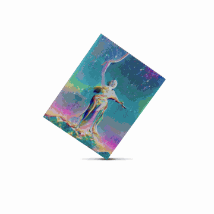
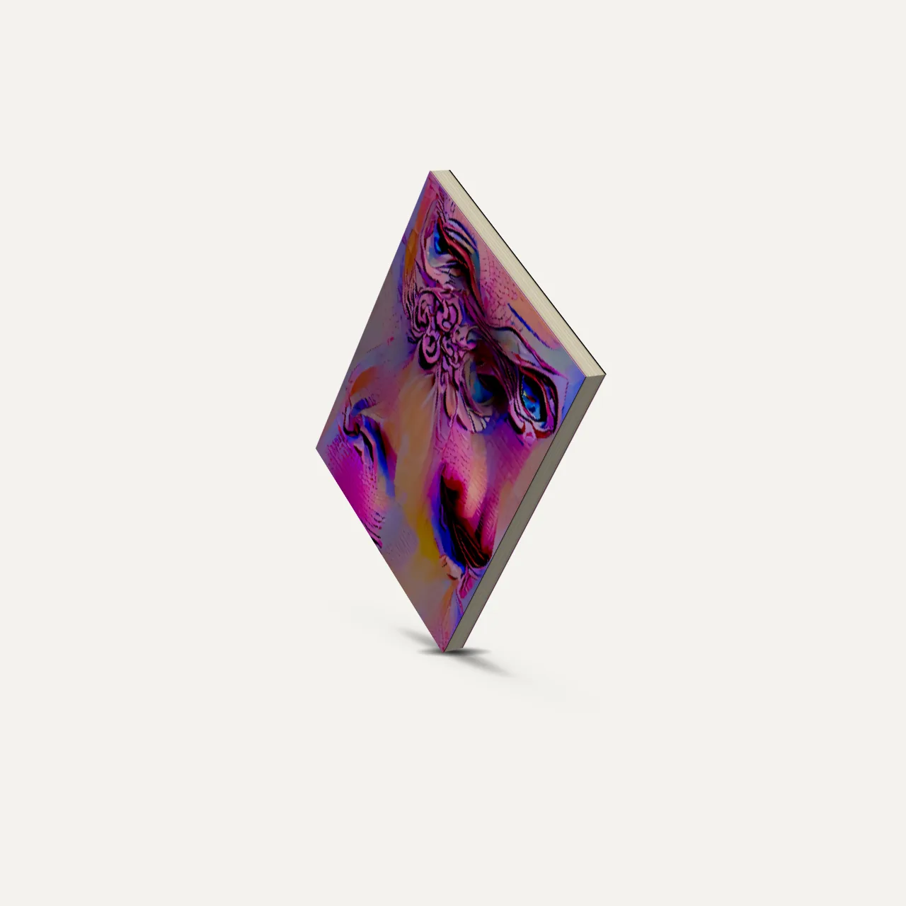
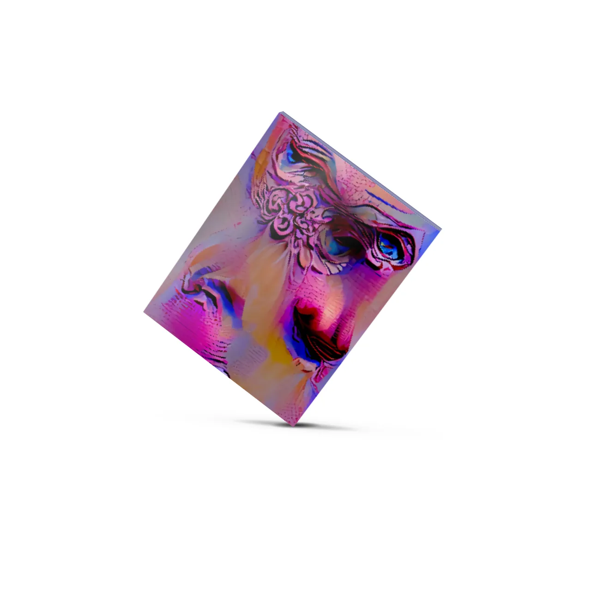
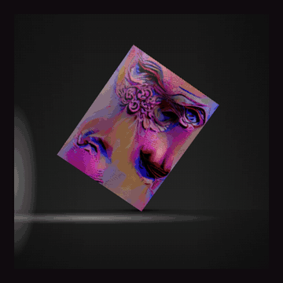
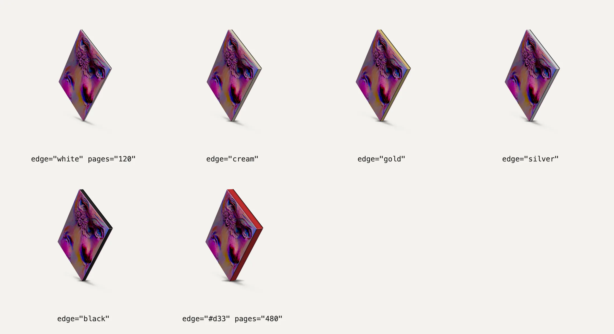
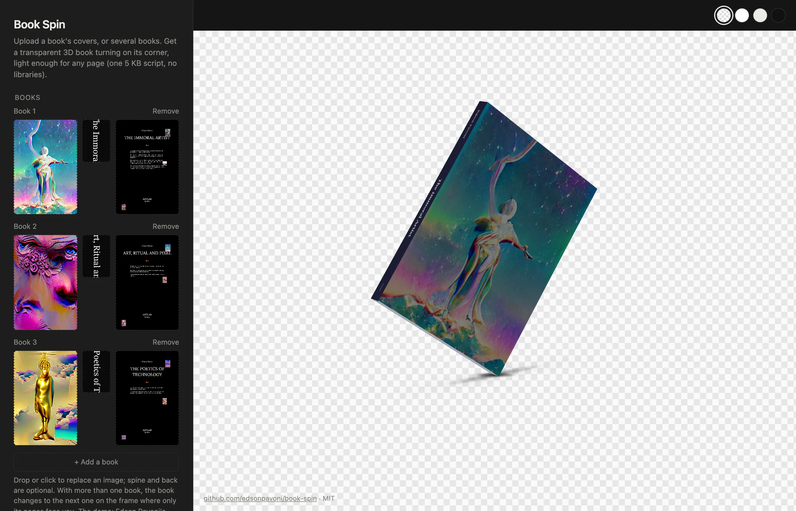

# Book Spin

<p align="center"></p>

A book standing on one corner, turning on its axis, on a transparent background with a soft studio shadow (light from above, like a softbox). Upload the front, spine and back, set the page count and the page-edge finish, and embed it anywhere.

**Tool:** https://edsonpavoni.github.io/book-spin/ (or open `index.html`) → upload the covers of one book or several → **Download HTML** (one self-contained file, images inside) or **Copy embed**.

No three.js, no WebGL: a CSS 3D box in a 5 KB (gzipped) web component with no dependencies. The light on each face is computed once and baked into CSS keyframes, so nothing runs per frame. It pauses when off screen and holds still for visitors who ask for reduced motion.

## Embed

```html
<book-spin front="front.jpg" spine="spine.jpg" back="back.jpg" pages="240" edge="cream"
  style="display:block;width:480px;height:600px"></book-spin>
<script src="https://cdn.jsdelivr.net/gh/edsonpavoni/book-spin@1.0.0/book-spin.js"></script>
```

| Attribute | What it does | Default |
|---|---|---|
| `front`, `spine`, `back` | cover images (spine and back optional). **Several books:** separate the URLs with `\|` (`front="a.jpg\|b.jpg\|c.jpg"`); the book changes to the next one on the frame where only its page edges face you, once a turn | — |
| `pages` | page count; with `paper` it sets the thickness | `200` |
| `paper` | one leaf, mm (80 g/m² offset ≈ 0.1) | `0.1` |
| `trim` | `width x height` in mm, e.g. `152x229` | front image ratio, 229 mm tall |
| `edge` | `white`, `cream`, `gold`, `silver`, `black`, or any CSS colour (sprayed edges) | `white` |
| `gloss` | cover highlight, 0–1 | `0.25` |
| `tilt` | how far the book leans onto its corner, degrees | `35` |
| `camera` | how far the camera looks down, degrees | `10` |
| `speed` | seconds per turn | `6.6` |
| `vary` | speed variation, 0–1: eases in and out of the front cover only; 0.5 comes to a smooth stop on it, up to 1 holds there longer (0 = steady) | `0` |
| `shadow` | strength of the soft floor shadow, 0–1 | `1` |
| `look` | `studio` (soft light from above) or `spotlight` (a low hard light from the left, a reflection sweeping across the covers, a cool rim on the edges) | `studio` |
| `backdrop` | `none` (transparent) or `dark` (a dark room with a pool of light on the wall and a streak on the floor) | `none` |

The book fills the element's height, so give the element a size. Images from another domain need CORS for the cover colour sampling; without it a neutral colour is used for the cover edges.

## Examples

Live: https://edsonpavoni.github.io/book-spin/examples/ · source in [`examples/`](examples/).

| | |
|---|---|
|  | **[One book](examples/one-book.html)** · studio light, cream edges, a steady turn |
|  | **[Three books](examples/trilogy.html)** · the covers change on the frame where only the page edges face you · spotlight, silver edges, `vary="0.3"` |
|  | **[Dark room](examples/dark-room.html)** · `look="spotlight" backdrop="dark"`, gold edges, `vary="0.6"` stops on the cover |
|  | **[Page edges](examples/edges.html)** · white, cream, gold, silver, black, any colour; thin and thick books |

<p align="center"></p>

The demo covers are Edson Pavoni's trilogy *Art Against Dystopia* ([edsonpavoni.art/en/read](https://edsonpavoni.art/en/read/)), with images from his series *Sacred in Flux*. They are here to show the tool; please use your own covers.

## License

Code: MIT. The demo cover images (`demo/`, `media/`) are © Edson Pavoni, not covered by the MIT license.
